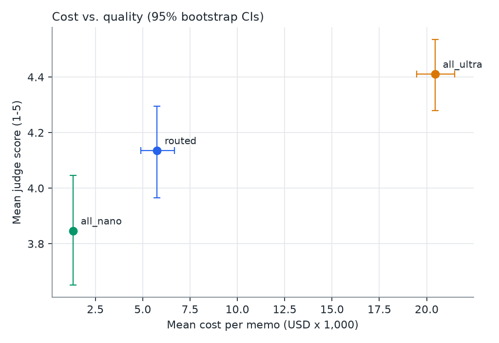
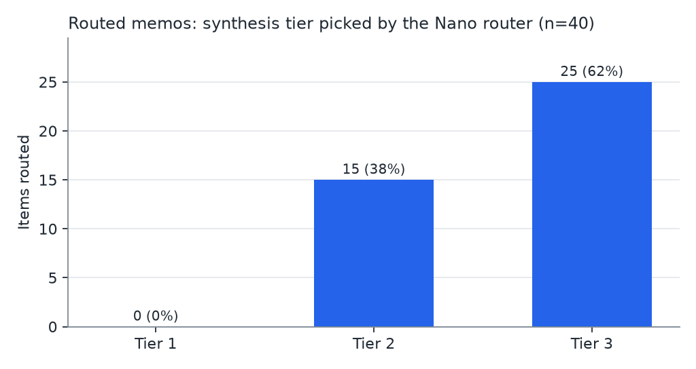
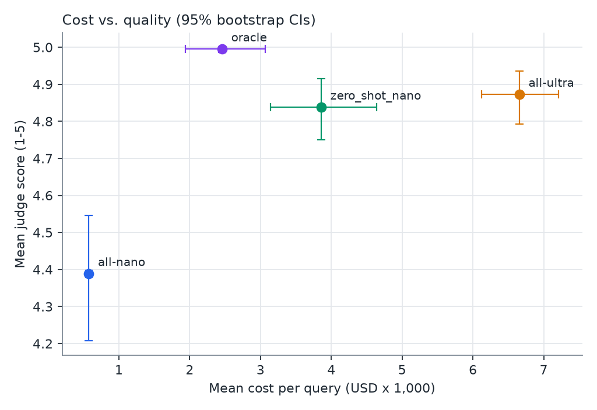
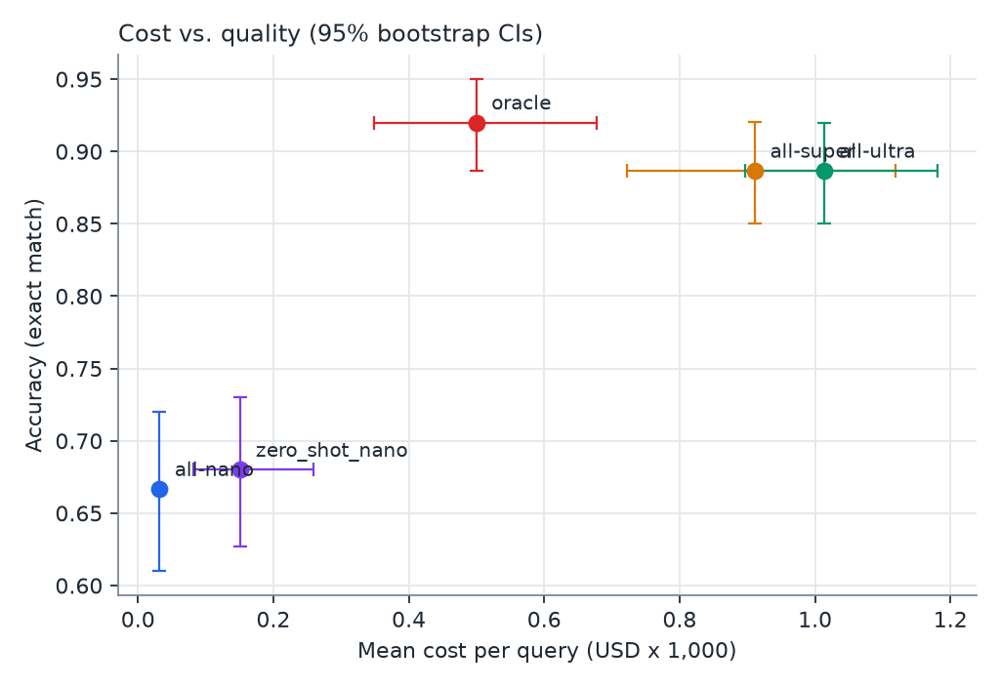

# NemoRoute

**Nemotron research memo agent.** A junior consultant asks a business-strategy question; the agent plans web searches (Tavily), extracts numbered facts from the sources, and writes a cited memo (bottom line, key findings, analysis, risks, next steps). A small, fast NVIDIA Nemotron router reads the question first and sends the memo-writing step to the cheapest Nemotron model that can do it well. All models are served at runtime by the **Nebius Token Factory** inference API.

Built for the Nebius x NVIDIA Global AI Hackathon (Best Apps and Agents track).

**Live demo:** https://nemoroute-demo.streamlit.app — 10 questions per browser session.

> **Project direction and task split:** see [`docs/ROADMAP.md`](docs/ROADMAP.md). The memo pipeline is `src/nemoroute/agent/memo.py` (route → plan → search → extract → synthesize); the router underneath it is evaluated on its own below.

| Tier | Model (Token Factory ID) | Handles |
|---|---|---|
| Router + Tier 1 | `nvidia/NVIDIA-Nemotron-3-Nano-30B-A3B` | definitions, factual lookups |
| Tier 2 | `nvidia/nemotron-3-super-120b-a12b` | frameworks, structured analysis |
| Tier 3 | `nvidia/Nemotron-3-Ultra-550b-a55b` | multi-step strategy, market sizing, ambiguous cases |

## Results

**Routed memos score 4.13 [3.96–4.29] vs all-Ultra 4.41 [4.28–4.53] at 28% of the all-Ultra cost ($0.00576 vs $0.02045 per memo).** Routing saves 72% of memo cost but gives up quality, and the gap traces mostly to the Nano extract step rather than to the router's tier choice (see below).

### Research memo benchmark

40 frozen consulting questions (25 generated, 15 hand-written), each run under all three strategies and judged blind by Ultra on accuracy, completeness, structure, actionability and grounding. For each question, Nano plans the searches once and every strategy gets the identical frozen sources. Memo cost covers every pipeline call (route, plan, extract, synthesize). Full report: [`results/memo_results.md`](results/memo_results.md).

| Strategy | n | Cost/memo | % of all-Ultra | Mean score | Pass rate (memo rule) | Pass rate (locked rule) | p50 latency |
|---|---|---|---|---|---|---|---|
| all-Nano | 39 | $0.00133 | 7% | 3.85 [3.65–4.05] | 25.6% [12.8–38.5] | 10.3% [2.6–20.5] | 43.91 s |
| all-Ultra | 40 | $0.02045 | 100% | 4.41 [4.28–4.53] | 62.5% [47.5–77.5] | 15.0% [5.0–27.5] | 27.17 s |
| **routed** | **40** | **$0.00576** | **28%** | **4.13 [3.96–4.29]** | **32.5% [17.5–47.5]** | **12.5% [2.5–22.5]** | **37.64 s** |

95% bootstrap CIs.
- **Memo rule:** mean ≥ 4.0 and accuracy ≥ 4. This is the labeling config's pre-calibration default, chosen before the full run.
- **Locked rule:** the calibrated labeling rule, mean ≥ 4.0 and accuracy ≥ 5. Few multi-claim memos reach it.
- **Excluded memo:** one all-Nano memo is excluded because its extract step was cut off at the token limit twice.

**Where routed loses quality.** The router sent 25 memos to Ultra, 15 to Super and none to Nano. On the 25 Ultra-routed questions, both strategies write the memo with Ultra, yet routed scores 4.06 vs 4.33. Routed is worse on 16 of those questions and better on 6. The gap is mostly accuracy (3.04 vs 3.60) and grounding (2.68 vs 3.24), the two criteria that depend on the extracted facts. Running extract on a larger model is the obvious next experiment.

Human agreement with the judge on 30 blind memos (10 per strategy): **70% (Cohen's κ = 0.33)**. The judge was more lenient: it passed 9 memos the human rejected, 6 of them all-Ultra, and missed none the human passed.





### Held-out consulting test set

The test split is frozen (seed 42, 20.2% of 600 labeled queries; 27 of 121 unresolved). Routing metrics use the 94 resolved queries. The router picks a tier with Nano; every strategy reuses the same cached answers and Ultra judge scores.

- Routing accuracy: **59.6%** (95% CI 50.0–70.2%); under-routing **9.6%**, over-routing **30.9%**.
- Unresolved rate: **22.3%** (27/121) — no tier passed the locked rubric.

| Strategy | Cost/query | % of all-Ultra | Pass rate | Mean score |
|---|---|---|---|---|
| all-Nano | $0.00058 | 9% | 44.7% [35.1–54.3] | 4.39 [4.21–4.55] |
| all-Ultra | $0.00666 | 100% | 77.7% [69.1–86.2] | 4.87 [4.79–4.94] |
| **router (zero-shot Nano)** | **$0.00386** | **58%** | **79.8% [71.3–87.2]** | **4.84 [4.75–4.91]** |
| oracle (cheapest passing tier) | $0.00246 | 37% | 100% | 4.99 [4.99–5.00] |

Resolved items only (n=94); 95% bootstrap CIs. On all 121 items, including unresolved, the router pass rate is 62.0% [53.7–70.2] vs all-Ultra 60.3% [52.1–68.6], at 66% of all-Ultra cost.



### MMLU-Pro public benchmark

300 frozen business/economics questions, scored by exact match; no judge. One of 900 tier answers had no extractable letter and is counted wrong.

| Strategy | Accuracy | Cost/query | % of all-Ultra |
|---|---|---|---|
| all-Nano | 66.7% [61.0–72.0] | $0.00003 | 3% |
| all-Super | 88.7% [85.0–92.0] | $0.00091 | 90% |
| all-Ultra | 88.7% [85.0–92.0] | $0.00101 | 100% |
| **router (zero-shot Nano)** | **68.0% [62.7–73.0]** | **$0.00015** | **15%** |
| oracle (cheapest correct tier) | 92.0% [88.7–95.0] | $0.00050 | 49% |

The router saves 85% against all-Ultra but gives up 20.7 points of accuracy; it is 24 points below the oracle. On this benchmark it routes 289/300 questions to Nano.



## How Nemotron and Token Factory are used

- **Inference.** Every model call goes through Token Factory's OpenAI-compatible endpoint (`https://api.tokenfactory.nebius.com/v1/`) using the `openai` Python SDK. See `src/nemoroute/client.py`.
- **Routing.** Nemotron 3 Nano classifies each query into tier 1, 2 or 3 (zero-shot, reasoning off). The router sits behind a `Router` protocol (`src/nemoroute/routers/base.py`) and is selected with `router.type` in `config.yaml` (or `--router`).
- **Answering.** The chosen tier's Nemotron model answers the query.
- **Dataset generation.** Nemotron 3 Ultra writes realistic consulting queries across three difficulty levels, deduplicated with TF-IDF cosine similarity.
- **Labeling.** Nano, Super and Ultra all answer every query. Nemotron 3 Ultra (reasoning on) grades each answer blind against a written rubric: accuracy, completeness, structure and actionability. The label is the cheapest tier whose answer passes.
- **Cost accounting.** Every call logs model, input/output tokens, latency and cost (from Token Factory per-token prices) to `logs/calls.jsonl`.

## Setup

```bash
python3 -m venv .venv
source .venv/bin/activate
pip install -r requirements.txt
cp .env.example .env
```

Add your Token Factory key to `.env` as `NEBIUS_API_KEY=...`. `.env` is gitignored.

All model IDs, prices, thresholds, paths and caps live in `config.yaml`.

## Run the demo app

```bash
streamlit run app/streamlit_app.py
```

Type a question. The app shows:
- the tier the router chose and its reasoning
- the answer
- that query's cost and latency

The sidebar tracks cumulative session cost and the estimated savings against sending everything to Ultra.

### Spend protection for the public demo

Set in `config.yaml` under `app:`:
- `session_query_cap`: queries allowed per browser session
- `daily_spend_cap_usd`: global spend cap per UTC day
- `total_spend_cap_usd`: lifetime cap
- `max_query_chars`: bound the question length; each LLM step is bounded by its role's `max_tokens`

App spend is logged to `logs/app_spend.jsonl`. The log is shared by every session in a single Streamlit process.

**Streamlit Community Cloud caveat:** the filesystem there is ephemeral, so `logs/app_spend.jsonl` resets whenever the app reboots. On that platform the daily and lifetime caps are best-effort only. For a hard backstop, give the deployed app a dedicated Token Factory API key with a low credit balance or spend limit. Provide the key through Streamlit secrets (`NEBIUS_API_KEY`).

## Pipeline

Every step that spends credits:
- prints a cost estimate first. It starts from config defaults and switches to observed per-role averages once a few real calls exist.
- shows lifetime spend against the $100 budget
- asks for confirmation before running
- takes `--limit N` for a dry run (default 20), or `--full` to process everything
- takes `--max-cost USD` as a hard stop mid-run

Every stage writes to append-only JSONL files and skips work that is already done, so interrupted runs resume without paying twice.

```bash
python scripts/probe_api.py
python scripts/generate_queries.py --dataset calibration --limit 20
python scripts/label_queries.py --dataset calibration --limit 20
python scripts/sample_for_human.py --target calibration
python scripts/tune_thresholds.py
python scripts/tune_thresholds.py --lock 4.0 4
python scripts/generate_queries.py --dataset full --full
python scripts/label_queries.py --dataset full --limit 20
python scripts/label_queries.py --dataset full --full
python scripts/split_dataset.py
python scripts/evaluate.py --full
python scripts/sample_for_human.py --target test
python scripts/score_human_agreement.py --target test
```

What each command does:
1. `probe_api.py` checks model IDs, hosts, the reasoning toggle and JSON support against the live API.
2. `generate_queries.py --dataset calibration --limit 20` generates the first 20 calibration queries (a dry run).
3. `label_queries.py --dataset calibration --limit 20` answers, judges and labels them, then prints the label distribution.
4. `sample_for_human.py --target calibration` exports calibration answers for human pass/fail labels.
5. `tune_thresholds.py` runs a grid search on the calibration set only. It makes no API calls.
6. `tune_thresholds.py --lock 4.0 4` locks the approved thresholds into `config.yaml`.
7. `generate_queries.py --dataset full --full` generates the full set, deduplicated against the calibration set.
8. `label_queries.py --dataset full --limit 20` is a dry run plus the class-balance check.
9. `label_queries.py --dataset full --full` labels the full set.
10. `split_dataset.py` makes a seeded, stratified 80/20 split and freezes the test set.
11. `evaluate.py --full` runs routing metrics, system metrics, charts and `results/results.md`.
12. `sample_for_human.py --target test` exports test answers for the human-agreement check.
13. `score_human_agreement.py --target test` computes percent agreement and Cohen's kappa between the human labels and the judge.

### Optional: frontier reference and public benchmark

Run these after the Phase 1 steps above. Both are optional. The reference model needs a paid `ANTHROPIC_API_KEY`.

```bash
python scripts/run_reference.py --full
python scripts/evaluate.py --full
python scripts/run_reference.py --judge reference_judge --full
python scripts/evaluate.py --full --judge reference_judge
python scripts/run_public_bench.py --full
python scripts/run_public_bench.py --full --reference
```

What each command does:
1. `run_reference.py` answers the test set with the closed reference model (`models.reference`, default Claude Opus 5.5) and grades those answers blind with the same Ultra judge and rubric. Re-running `evaluate.py` adds a `reference` row.
2. `run_reference.py --judge reference_judge` re-grades the reference answers and all Nemotron tier answers with the reference model as judge. This checks for Ultra grading its own answers. `evaluate.py --judge reference_judge` writes that view to `results/judge_reference_judge/`.
3. `run_public_bench.py` samples 300 MMLU-Pro business and economics questions (frozen on first run). Every tier answers them, plus the reference model with `--reference`. It routes them and scores all strategies by exact match into `results/public_bench/`.

**Billing.** The `$100` budget guard counts only Token Factory spend. Reference-model calls are billed by Anthropic. Cost estimates list them separately, and every call is still logged.

### Evaluation hygiene

- **Calibration is kept separate.** Thresholds are tuned only on a separate 60-query calibration set, before the full set is labeled or split. Calibration queries never enter the test set, and `split_dataset.py` checks this.
- **The pipeline enforces the order.** `label_queries.py --full` (full set), `split_dataset.py` and `evaluate.py` all refuse to run until thresholds are locked.
- **Threshold changes are flagged.** Locked values are recorded in `config.yaml` and in `results.md`. If thresholds change after a test evaluation, `results.md` says so.
- **Unresolved queries are counted, not hidden.** A query where no tier passes is labeled `unresolved`, not tier 3. It is excluded from training and from routing accuracy, and its rate is reported separately.
- **The test set is frozen.** It is read only by `evaluate.py` and `sample_for_human.py`.
- **Baselines share the same answers.** Every strategy (all-Nano, all-Ultra, router, oracle) reuses the same cached answers and judge scores. Router cost and latency include the routing call.

### Limitations

- **Self-grading.** Ultra grades answers it also produced. The mitigations:
  - blind judging
  - absolute rubric scores rather than pairwise comparison
  - a human-agreement check on 30 blind memos
- **Labels depend on the judge.** They reflect this judge, rubric and threshold, not ground truth.
- **Memo benchmark caveats:**
  - **Small sample.** n = 40 questions per strategy, so the CIs are wide.
  - **Two pass rules.** The headline pass rate uses a memo-specific rule (accuracy ≥ 4) rather than the locked labeling rule (accuracy ≥ 5); both are reported.
  - **all-Ultra plans with Nano.** It is all-Ultra except for the shared planning step, so that all strategies see the same sources.
  - **Failures kept in the results.** One all-Nano memo failed twice and is excluded. One memo's synthesis was cut off at the token limit and is scored as is. One all-Nano memo has no citations and is also scored as is.
- **No fine-tuning.** Token Factory can't fine-tune Nemotron, and hosting custom weights live through judging isn't affordable, so the router is prompted rather than trained (see `docs/ROADMAP.md`).
- **The closed reference model is for evaluation only.** It never answers in the product path. It runs at its default thinking depth (effort `medium`), while the Nemotron tiers answer with reasoning off. Refusals are recorded as empty answers and score as fails.

## Tests

```bash
pytest
```

Tests use a fake client and make no API calls.

## Deploying

The app is live at **[https://nemoroute-demo.streamlit.app](https://nemoroute-demo.streamlit.app)**.

- Entry point: `app/streamlit_app.py`
- Python ≥ 3.11
- Secrets: `NEBIUS_API_KEY` (low-limit Token Factory key) and `TAVILY_API_KEY` (Tavily search key)
- Writable paths fall back to `/tmp` when the repo directory is read-only

## Credits

Built with Nebius Token Factory inference, NVIDIA Nemotron models and Tavily web search.

## License

MIT. See [LICENSE](LICENSE).
