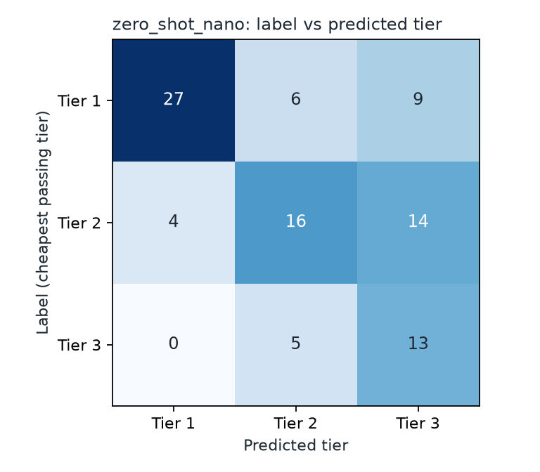
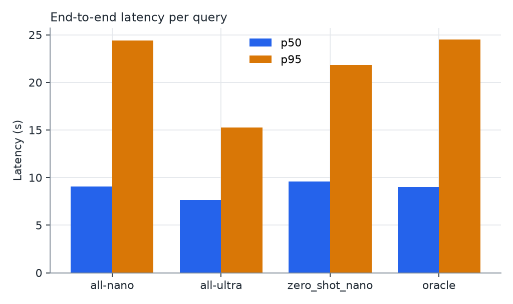

# Held-out test set results

Locked thresholds: pass_threshold=4.0, min_accuracy=5 (locked 2026-10-21T02:54:17+00:00, source: calibration).

Items: 121. Unresolved (no tier passed): 27 (22.3%).
Router fallbacks (unparseable output, sent to the top tier): 0.

## Routing (zero_shot_nano, resolved items only, n=94)

- Accuracy: 59.6% (95% CI [50.0, 70.2]%)
- Under-routing rate (sent to a tier below the label): 9.6%
- Over-routing rate (sent to a tier above the label): 30.9%

| Tier | Precision | Recall |
|---|---|---|
| 1 | 0.87 | 0.64 |
| 2 | 0.59 | 0.47 |
| 3 | 0.36 | 0.72 |

Confusion matrix (rows = label, columns = predicted):

| | Pred 1 | Pred 2 | Pred 3 |
|---|---|---|---|
| Label 1 | 27 | 6 | 9 |
| Label 2 | 4 | 16 | 14 |
| Label 3 | 0 | 5 | 13 |

## System comparison: resolved items (headline)

Cost and latency for the router strategy include the router call. All strategies reuse the same cached answers and judge scores, so they are compared on identical outputs.

| Strategy | n | Cost / query (USD) | 95% CI | Cost as % of all-Ultra | p50 latency (s) | p95 latency (s) | Mean score | 95% CI | Pass rate | 95% CI | Tier mix |
|---|---|---|---|---|---|---|---|---|---|---|---|
| all-nano | 94 | 0.00058 | [0.00053, 0.00062] | 9% | 9.06 | 24.41 | 4.39 | [4.21, 4.55] | 44.7% | [35.1, 54.3]% | T1:94 |
| all-ultra | 94 | 0.00666 | [0.00612, 0.00721] | 100% | 7.66 | 15.25 | 4.87 | [4.79, 4.94] | 77.7% | [69.1, 86.2]% | T3:94 |
| zero_shot_nano | 94 | 0.00386 | [0.00314, 0.00464] | 58% | 9.57 | 21.84 | 4.84 | [4.75, 4.91] | 79.8% | [71.3, 87.2]% | T1:31, T2:27, T3:36 |
| oracle | 94 | 0.00246 | [0.00194, 0.00307] | 37% | 8.98 | 24.49 | 4.99 | [4.99, 5.00] | 100.0% | [100.0, 100.0]% | T1:42, T2:34, T3:18 |

## System comparison: all items (oracle sends unresolved items to Ultra)

| Strategy | n | Cost / query (USD) | 95% CI | Cost as % of all-Ultra | p50 latency (s) | p95 latency (s) | Mean score | 95% CI | Pass rate | 95% CI | Tier mix |
|---|---|---|---|---|---|---|---|---|---|---|---|
| all-nano | 121 | 0.00061 | [0.00057, 0.00065] | 9% | 9.36 | 26.93 | 4.20 | [4.04, 4.35] | 34.7% | [26.4, 43.8]% | T1:121 |
| all-ultra | 121 | 0.00687 | [0.00645, 0.00730] | 100% | 7.86 | 14.57 | 4.77 | [4.69, 4.83] | 60.3% | [52.1, 68.6]% | T3:121 |
| zero_shot_nano | 121 | 0.00451 | [0.00384, 0.00517] | 66% | 9.82 | 25.71 | 4.69 | [4.59, 4.79] | 62.0% | [53.7, 70.2]% | T1:31, T2:35, T3:55 |
| oracle | 121 | 0.00361 | [0.00299, 0.00425] | 53% | 8.90 | 22.79 | 4.86 | [4.81, 4.91] | 77.7% | [70.2, 85.1]% | T1:42, T2:34, T3:45 |

## Charts

